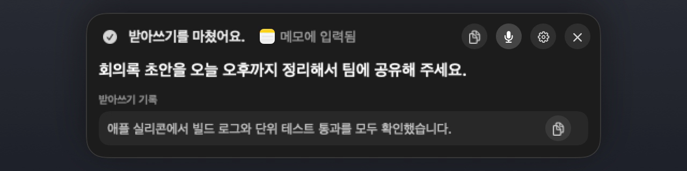
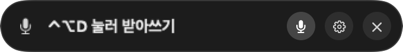
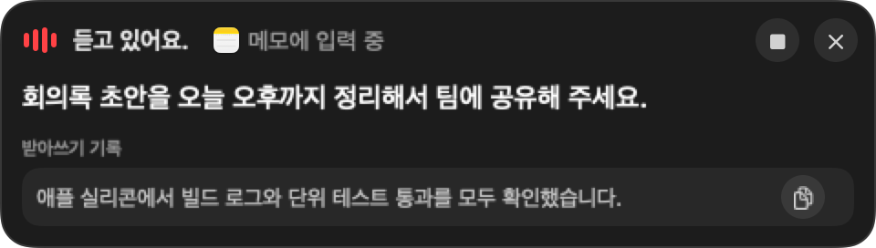
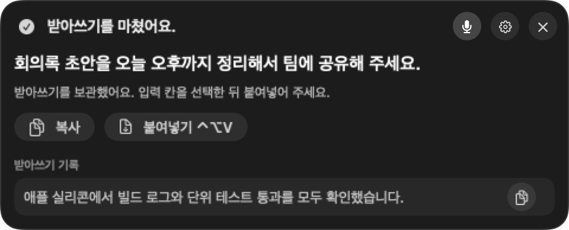
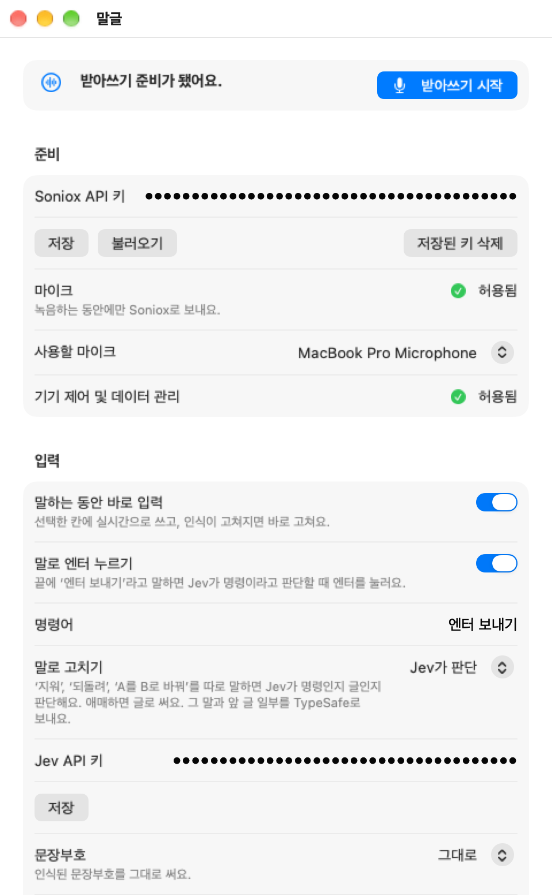
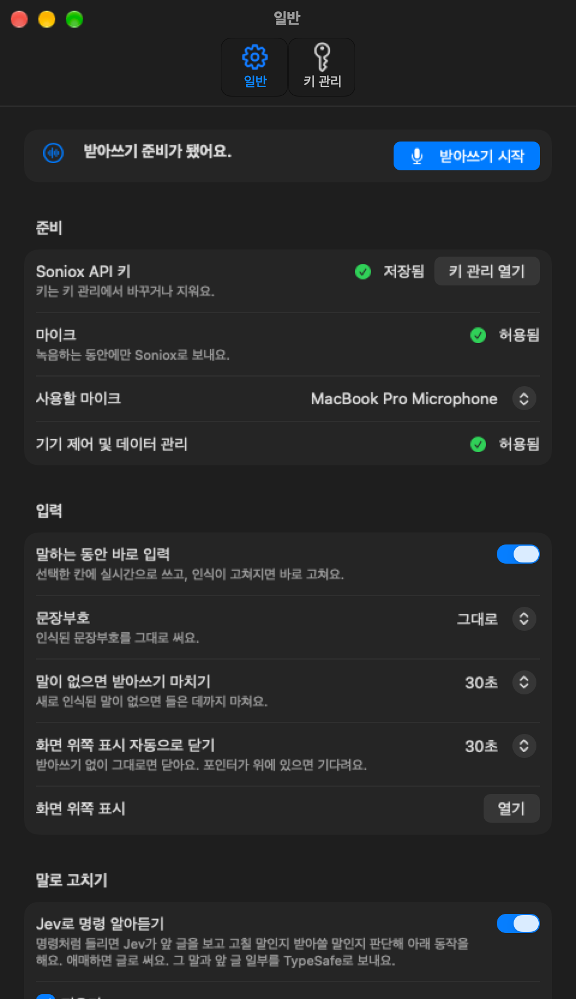

<p align="center">
  
</p>

<h1 align="center">말글</h1>

<p align="center">
  말하면, 지금 쓰고 있는 칸에 글이 돼요.
</p>

<p align="center">
  <a href="https://github.com/floweredao/malgeul/releases/latest"><b>내려받기</b></a>
  ·
  <a href="README.md">English</a>
  ·
  macOS 15+ · Apple silicon
</p>

<p align="center">
  
</p>

<details>
<summary><b>▶ 7초 데모 영상 보기</b></summary>

https://github.com/user-attachments/assets/06da1df2-3689-483b-b5ae-cb34d0913a19

</details>

## 왜 말글인가요

- **어디서나 바로 써요.** 메모, 브라우저, 터미널 어디든 클릭해 둔 칸에 써져요.
- **말로 시작하고 고쳐요.** "Hey Computer"로 시작하고, "지워"·"되돌려"로 고쳐요.
- **흐름을 끊지 않아요.** 오버레이는 포커스를 가져가지 않아요. 결과는 닫을 때까지 남아요.

## 설치

1. [최신 릴리스](https://github.com/floweredao/malgeul/releases/latest)에서 `.zip`을 받아 앱을 응용 프로그램 폴더로 옮겨요.
2. 앱을 열고 설정에 [Soniox](https://soniox.com) API 키를 저장해요.
3. 마이크와 손쉬운 사용을 허용해요.

> 받은 파일 이름은 `Speech2Text.app`이에요. 화면에는 **말글**로 보여요. 권한과 업데이트가 끊기지 않게 파일 이름은 그대로 두었어요.

## 쓰는 법

- **시작·끝**: <kbd>⌃</kbd><kbd>⌥</kbd><kbd>D</kbd> 또는 "Hey Computer"
- **마지막 결과 붙여넣기**: <kbd>⌃</kbd><kbd>⌥</kbd><kbd>V</kbd>
- **취소**: 메뉴 막대 메뉴의 **받아쓰기 취소**
- **저절로 끝남**: 30초 동안 말이 없으면 끝나요

## 말로 고치기

받아쓰는 중에 이렇게 말하면 고쳐요.

| 말 | 하는 일 |
| --- | --- |
| "지워" · "delete that" | 마지막 문장을 지워요 |
| "한 단어 지워" | 마지막 단어를 지워요 |
| "다 지워" · "clear all" | 받아쓴 글을 모두 지워요 |
| "되돌려" · "undo" | 방금 고친 것을 되돌려요 |
| "A를 B로 바꿔" | 마지막 A를 B로 바꿔요 |
| "엔터 보내기" · "send enter" | 끝내고 Return을 눌러요 |

명령인지 글인지는 설정 › 입력 › **말로 고치기**에서 고른 방식이 정해요.

- **Jev가 판단** (추천): 명령만 말하면 TypeSafe Jev가 앞 글을 보고 판단해요. 애매하면 글로 써요. Jev API 키가 필요해요.
- **트리거 단어**: 정해 둔 단어 바로 뒤에 말할 때만 명령이에요. 단어는 설정에서 바꿔요.
- **끄기**: 모두 글로 써요.

## 말로 시작하기

- **호출어**: 설정 › 음성으로 시작에서 켜요. "Hey Computer"로 시작하고, 끝에 다시 말하면 끝나요.
- **한국어 억양도 들어요**: macOS 26부터는 기기 내 음성 인식이 "헤이 컴퓨터"도 알아들어요.
- **소리는 맥 안에서만**: 호출어를 듣는 소리는 저장하거나 보내지 않아요.
- **단축어·음성 제어**: **받아쓰기 시작**·**받아쓰기 끝내기** 동작을 쓸 수 있어요.

## 둘러보기

대기 중에는 노치 아래 캡슐 하나예요.

<p align="center">
  
</p>

말하는 동안 실시간 글과 입력 중인 앱이 보여요.

<p align="center">
  
</p>

끝나면 결과와 복사·붙여넣기 버튼이 남아요.

<p align="center">
  
</p>

설정 창이에요. 라이트, 그다음 다크예요.

<p align="center">
  
</p>

<p align="center">
  
</p>

## 자세히

<details>
<summary><b>권한과 준비</b></summary>

- **Soniox API 키**: 이 앱 전용 키체인에만 저장해요. Soniox 요금은 따로 들어요.
- **마이크**: 처음 녹음할 때 macOS가 물어요. 설정 › **사용할 마이크**에서 골라요.
- **손쉬운 사용**: 다른 앱에 바로 쓰려면 필요해요. 설정에서 **허용 요청**을 눌러요.
- macOS 27에서는 이 권한 이름이 **Device Control and Data Management**예요.

</details>

<details>
<summary><b>단축키</b></summary>

- 설정 › **단축키**에서 동작마다 바꿔요.
- 키 조합: ⌃·⌥·⌘ 중 하나와 함께 누르는 키, 또는 F1–F20.
- 수정 키만: 양쪽 ⇧, 오른쪽 ⌘처럼 수정 키만 눌렀다 떼요.
- 여러 번 누르기: 같은 키를 0.5초 안에 두세 번 눌러 저장해요.

</details>

<details>
<summary><b>입력이 어떻게 들어가나요</b></summary>

- 말하는 동안 고른 칸에 실시간으로 써요.
- 다른 칸으로 옮기면 실시간 입력이 멈춰요. 결과는 오버레이에 남아요.
- 취소하면 이번에 쓴 글자만 지워요.
- 앱은 스스로 Return을 보내지 않아요. "엔터 보내기"만 예외예요.
- **문장부호**는 설정 › 입력에서 그대로·쉼표 빼기·모두 빼기 중에 골라요.
- **사전**에 적은 단어는 적힌 대로 인식되게 도와요.

</details>

<details>
<summary><b>문제가 생기면</b></summary>

- **글이 안 들어갔어요**: 오버레이의 **복사** 또는 **붙여넣기**(<kbd>⌃</kbd><kbd>⌥</kbd><kbd>V</kbd>)를 써요.
- **권한이 있는데 없다고 해요**: 시스템 설정 목록에서 앱을 **−**로 지우고 **+**로 다시 넣어요.
- **녹음이 시작되지 않아요**: 설정 맨 위에 빠진 준비 항목이 보여요.
- **호출어가 안 먹어요**: 설정에서 마이크와 **민감도**를 확인해요.
- **터미널에서 멈춰요**: 터미널은 커서 위치를 알려 주지 않아요. 끝난 뒤 붙여넣어요.
- **음성 제어가 글을 두 번 넣어요**: 음성 제어를 명령 모드로 바꿔요.
- **앱이 열리지 않아요**: 시스템 설정 › 개인정보 보호 및 보안 › **그래도 열기**를 눌러요.

</details>

<details>
<summary><b>개인정보</b></summary>

- 소리는 받아쓰는 동안에만 Soniox로 보내요.
- 녹음 파일을 남기지 않아요.
- 받아쓰기 기록은 메모리에만 있다가 앱을 끄면 사라져요.
- 호출어 소리는 맥 밖으로 나가지 않아요.

</details>

<details>
<summary><b>소스에서 빌드</b></summary>

Apple silicon Mac과 Xcode Command Line Tools가 필요해요.

```sh
bash scripts/test.sh        # 테스트
bash scripts/build-app.sh   # build/Speech2Text.app 만들기
```

- 빌드 전에 호출어 모델을 `Vendor/`에 자동으로 받아요.
- 애드혹 서명은 `SPEECH2TEXT_SIGNING_IDENTITY=-`로 해요.
- `bash scripts/capture-readme-images.sh`가 이 문서의 사진과 GIF를 다시 만들어요.

</details>

## 라이선스

[MIT](LICENSE). 함께 든 오픈소스의 고지는 [THIRD_PARTY_NOTICES.md](THIRD_PARTY_NOTICES.md)에 있어요.
