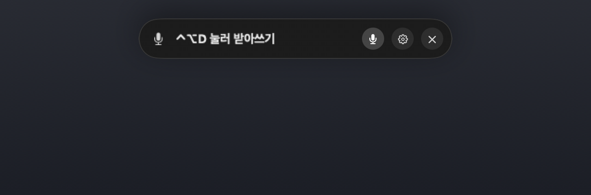

<p align="center">
  
</p>

<h1 align="center">말글 · Malgeul</h1>

<p align="center">
  말하면, 지금 쓰고 있는 입력 칸에 글이 됩니다.<br>
  macOS 메뉴 막대 받아쓰기 앱
</p>

<p align="center">
  <a href="README.md">English</a> · <b>한국어</b>
</p>

<p align="center">
  <a href="https://github.com/floweredao/malgeul/releases/latest"><b>최신 릴리스 내려받기</b></a>
  &nbsp;·&nbsp; macOS 15 이상, Apple silicon
  &nbsp;·&nbsp; <a href="LICENSE">MIT</a>
</p>

<p align="center">
  
</p>

## 무엇인가요

말글은 작은 메뉴 막대 앱입니다. 아무 앱의 입력 칸을 클릭하고 단축키를 누르거나 "Hey Computer"라고 말한 뒤 이야기하면, 말하는 동안 그 칸에 글이 써지고 노치 아래 작은 오버레이에 인식 중인 문장이 보입니다. 음성은 내 [Soniox](https://soniox.com) API 키로 Soniox에 보내 인식하며, 어디에도 저장하지 않습니다. 전사는 앱을 끌 때까지 메모리에만 있습니다.

말한 그대로 씁니다. 문장을 고쳐 쓰지 않고, 말로 하는 고치기도 트리거 단어로 요청할 때만 명령으로 듣습니다.

## 왜 좋은가요

- **고른 칸에 실시간으로 씁니다.** 일반 Mac 입력 칸은 접근성으로 글을 바꾸고, 웹 편집기와 터미널에는 그 앱에만 키 입력을 보냅니다. 인식이 앞말을 고치면 바뀐 끝부분만 지우고 다시 씁니다.
- **방해하지 않습니다.** 오버레이는 키보드 포커스를 가져가지 않아 쓰던 앱에서 계속 타자하고 클릭할 수 있습니다. 끌어서 옮길 수 있고, 30초 동안 아무 일이 없으면 스스로 닫힙니다(설정에서 바꿀 수 있음).
- **잃어버리지 않습니다.** 결과는 닫을 때까지 남고, 칸에 글이 들어가지 않았을 때를 위해 복사와 붙여넣기 버튼이 있습니다. 최근 받아쓰기 20개는 접었다 펼 수 있는 기록으로 메모리에만 둡니다.
- **말로 고칩니다.** "자비스 지워"는 마지막 문장을 지우고, "자비스 되돌려"는 되돌리고, "자비스 A를 B로 바꿔"는 단어를 바꾸고, "자비스 엔터 보내기"는 Return을 누릅니다. 영어 명령("delete that", "undo", "replace A with B", "send enter")도 됩니다. 트리거 단어(기본 "자비스")는 바꿀 수 있습니다.
- **말로 시작합니다.** 단축어 앱과 음성 제어가 실행할 수 있는 **받아쓰기 시작**·**받아쓰기 끝내기** 동작이 들어 있습니다. 호출어를 켜고 "Hey Computer"라고 말해도 되며, 호출어는 이 Mac 안에서만 듣습니다.
- **한국어와 영어.** 앱, 오버레이, 이 README가 두 언어로 있고, 인식은 한국어와 영어에 맞춰져 있습니다.
- **스스로 최신을 유지합니다.** GitHub 릴리스를 하루 한 번 확인하고 앱 안에서 업데이트하며, 메뉴의 **업데이트 확인…** 항목으로 바로 확인할 수도 있습니다.

## 둘러보기

오버레이는 노치 아래에 있습니다. 대기 중에는 캡슐 하나입니다.

<p align="center">
  
</p>

말하는 동안에는 실시간 전사, 글이 들어가는 앱, 이전 받아쓰기가 보입니다.

<p align="center">
  
</p>

마치면 결과가 남고, 글이 들어가지 않았을 때를 위한 복사·붙여넣기가 있습니다.

<p align="center">
  
</p>

설정 창에는 API 키, 마이크와 권한, 입력 방식, 사전, 단축키, 음성으로 시작이 있습니다. 라이트, 그다음 다크입니다.

<p align="center">
  
  &nbsp;&nbsp;
  
</p>

오버레이는 라이트·다크 어느 쪽에서나 어두운 표면으로 보이도록 만들었습니다.

## 설치

1. [최신 릴리스](https://github.com/floweredao/malgeul/releases/latest)에서 `.zip`을 내려받아 압축을 풀고 `Speech2Text.app`을 응용 프로그램 폴더로 옮깁니다. 디스크의 번들 이름은 `Speech2Text.app` 그대로이고, 메뉴 막대와 창, 설정에는 **말글**(영어 Mac에서는 **Malgeul**)로 보입니다. 이미 허용한 권한과 업데이트가 끊기지 않도록 파일 이름과 번들 식별자는 일부러 바꾸지 않았습니다.
2. 앱을 엽니다. 열 수 없다는 안내가 나오면 시스템 설정 › 개인정보 보호 및 보안 › 보안에서 **그래도 열기**를 누릅니다. 버전마다 한 번입니다.
3. 그다음부터는 앱 안에서 업데이트합니다.

## 준비

메뉴 막대의 파형 아이콘 › **설정…** 메뉴를 엽니다. 준비 항목이 빠져 있으면 설정이 저절로 열립니다.

1. **Soniox API 키.** 붙여넣고 **저장**을 누릅니다. 키는 이 앱 전용 Keychain 항목에만 보관되고 다음 실행 때 불러오며, **저장된 키 삭제**로 이 Mac에서 지웁니다. Soniox 사용 요금은 따로 듭니다.
2. **마이크.** 처음 녹음할 때 macOS가 묻습니다. **사용할 마이크**에서 마이크를 고릅니다(기본값은 시스템 기본 입력).
3. **손쉬운 사용.** 다른 앱에 실시간으로 쓰기와 수정 키만 누르는 단축키에는 다른 앱을 제어하는 권한이 필요합니다. **허용 요청**을 누른 뒤 시스템 설정에서 말글을 허용하세요. macOS 27에서는 이 항목이 **Device Control and Data Management**(기기 제어 및 데이터 관리)이고, macOS 26 이하에서는 **손쉬운 사용**입니다. 시스템 설정에서 돌아오면 상태가 갱신됩니다.

목록에 허용된 것으로 보이는데도 권한이 없다고 나오면, 항목을 **−** 버튼으로 지우고 **+** 버튼으로 `/Applications/Speech2Text.app`을 다시 추가하세요.

## 받아쓰기

1. 아무 앱에서 글을 넣을 입력 칸을 클릭합니다.
2. **⌃⌥D**를 누르고 말합니다. 마이크가 켜지는 즉시 녹음이 시작되니 바로 말해도 됩니다. Soniox 연결은 뒤에서 이어지고 실패하면 한 번 더 시도합니다. 인터넷이 끊겨 있으면 시작하지 않고 바로 알려 줍니다.
3. **⌃⌥D**를 다시 누르거나 마치기 버튼을 누르거나, 그냥 말을 멈춥니다. 새 말이 30초 동안 없으면 받아쓰기가 스스로 마칩니다(설정 › 입력 › **말이 없으면 받아쓰기 마치기**). 녹음은 최대 30분입니다.

실시간으로 쓰는 동안 이렇게 동작합니다.

- 말하는 도중 다른 칸이나 앱으로 옮기면 실시간 입력이 멈추고 결과는 오버레이에 남습니다. 옮기기 전에 한 말은 새 칸에 넣지 않고, 그 뒤에 한 말만 새 칸에 들어갑니다.
- 터미널은 커서 위치를 알려 주지 않아서, 받아쓰는 동안 그 칸에서 키를 누르거나 클릭해도 멈춥니다. 앱은 스스로 Return을 보내지 않으므로 명령이 실행되는 일이 없습니다. 유일한 예외는 말로 하는 엔터 명령이고, 이것도 같은 칸에만 보냅니다.
- 취소하면 이번 받아쓰기로 쓴 글자만 지웁니다.
- **문장부호**(설정 › 입력): **그대로**, **쉼표 빼기**(마침표·물음표·느낌표와 1,000 같은 숫자 속 쉼표는 남김), **모두 빼기**(3.14 같은 숫자는 그대로). 말로 하는 명령은 들은 그대로의 말로 알아듣습니다.
- **사전**(설정 › 사전): 적어 둔 단어는 받아쓰기를 시작할 때 Soniox에 문맥으로 보내 적힌 대로 인식되게 합니다.

### 단축키

설정 › **단축키**에 동작마다 한 줄이 있습니다. 받아쓰기 시작/마무리(기본 ⌃⌥D), 마지막 결과 붙여넣기(기본 ⌃⌥V), 받아쓰기 취소(기본 없음). 단축키 버튼을 누른 뒤 원하는 키를 누르면 저장되고, Esc는 기록을 취소하며 ✕는 그 단축키를 끕니다.

- **키 조합**: ⌃·⌥·⌘ 중 하나 이상과 함께 누르는 키, 또는 F1–F20. 글자 입력을 막는 키(수식 키 없는 글자, ⇧+글자)는 받지 않습니다.
- **수정 키만**: 양쪽 ⇧, 오른쪽 ⌘, ⌘+⌥처럼 수정 키만 눌렀다 떼는 동작. 왼쪽·오른쪽을 구분합니다. 누르는 사이 다른 키를 치거나 클릭했거나 0.6초보다 오래 누르고 있었으면 단축키로 보지 않습니다. 손쉬운 사용 권한이 필요합니다.
- **여러 번 누르기**: 기록할 때 같은 키를 0.5초 안에 두세 번 연달아 누르면 두 번·세 번 누르기로 저장됩니다.

### 말로 고치기

명령은 **트리거 단어**(설정 › 입력, 기본 "자비스") 바로 뒤에 올 때만 명령이고, 트리거 단어 없이 말한 같은 말은 그대로 글로 씁니다.

| 이렇게 말하면 | 이렇게 됩니다 |
| --- | --- |
| "자비스 지워" · "자비스 delete that" | 마지막 문장을 지웁니다 |
| "자비스 한 단어 지워" · "자비스 delete last word" | 마지막 단어를 지웁니다 |
| "자비스 다 지워" · "자비스 clear all" | 지금까지 받아쓴 글을 모두 지웁니다 |
| "자비스 되돌려" · "자비스 undo" | 마지막 고침을 되돌립니다 |
| "자비스 A를 B로 바꿔" · "자비스 replace A with B" | 마지막에 나온 A를 B로 바꿉니다 |
| "자비스 엔터 보내기" · "자비스 send enter" | 받아쓰기를 마치고 같은 칸에 Return을 누릅니다 |

설정 › 입력 › **말로 고치기**에서 **Jev가 판단**을 고르면 트리거 단어 없이 "지워", "되돌려", "A를 B로 바꿔"라고만 말해도 TypeSafe Jev 모델이 앞 글을 보고 고치라는 말인지 판단합니다. 명령으로 끝나는 말 덩이와 그 앞 글 400자까지만 보내고, Jev가 확신하지 못하거나 실패하거나 1.5초를 넘기면 글로 씁니다. Jev API 키는 이 앱의 Keychain에 둡니다. **끄기**는 모두 글로 씁니다.

## 말로 시작하기

말글에는 단축어 앱과 음성 제어가 실행할 수 있는 **받아쓰기 시작**과 **받아쓰기 끝내기** 동작이 있습니다. 시작은 이미 받아쓰는 중이면 끝내지 않고, 끝내기는 받아쓰는 중이 아니면 새로 시작하지 않습니다. 단축키로 쓸 때처럼 먼저 입력할 칸을 클릭해 두세요. 설정 › **음성으로 시작**에도 같은 안내가 있습니다.

- **호출어**(기본 꺼짐). **호출어로 시작·끝내기**를 켜고 "Hey Computer"라고 말하면 받아쓰기를 시작하고, 받아쓰다 끝에 다시 말하면 마칩니다. 듣기는 모두 이 Mac 안에서 합니다. 앱에 든 작은 키워드 모델과, macOS 26부터는 macOS 기기 내 음성 인식기가 함께 듣습니다. 한국어 억양으로 말한 "헤이 컴퓨터"는 영어 키워드 모델 혼자서는 거의 듣지 못하고, 기기 내 인식기가 알아듣습니다. 들은 소리는 저장하거나 보내지 않습니다. 듣는 동안 마이크가 켜져 있고(메뉴 막대의 주황색 점) 받아쓰는 동안에는 받아쓰기에 마이크를 넘기며, 블루투스 이어폰은 그동안 음질이 낮아질 수 있습니다. 호출어는 영어 글자로 적는 설정이고 **민감도**는 낮음·보통·높음입니다. 지어낸 이름보다 실제 영어 단어를 훨씬 잘 듣습니다.
- **음성 제어.** 단축어 앱에서 새 단축어에 말글의 **받아쓰기 시작** 동작을 넣습니다. 시스템 설정 › 손쉬운 사용 › 음성 제어 › 명령에서 +를 눌러 말할 문구를 적고, 동작은 **단축어 실행**으로 골라 그 단축어를 지정합니다. **받아쓰기 끝내기**도 같은 방법으로 만듭니다. 음성 제어는 켜져 있는 동안 계속 듣고 말한 내용을 직접 입력하기도 하므로, 글이 두 번 들어가면 음성 제어를 명령 모드로 바꿔 주세요.

## 문제가 생기면

- **글이 들어가지 않았어요.** 결과는 오버레이에 있습니다. **복사**는 클립보드에 담아 ⌘V로 붙여넣게 하고, **붙여넣기**(또는 ⌃⌥V)는 지금 선택한 칸에 보냅니다. 메뉴 막대 메뉴에도 받아쓰기 취소, 마지막 받아쓰기 복사, 마지막 받아쓰기 붙여넣기가 있어 ⌃F8과 방향키로 쓸 수 있습니다. 붙여넣기가 들어갔는지 알려 주지 않는 앱에서는 성공을 단정하지 않고 **붙여넣기를 요청했어요**라고 보입니다.
- **목록에 있는데도 권한이 없다고 해요.** 개인정보 보호 항목에서 **−** 버튼으로 지우고 **+** 버튼으로 `/Applications/Speech2Text.app`을 다시 추가하세요. 수정 키만 누르는 단축키도 같은 권한이 필요합니다.
- **녹음이 시작되지 않아요.** 설정이 준비 항목 세 가지 중 무엇이 빠졌는지 보여 줍니다. 키 없음, 마이크 거부·연결 끊김·무음, Soniox 401/403은 다시 시도해도 같은 결과라 오버레이에 **설정 확인**만 나오고, 인터넷 없음을 포함한 그 밖의 오류에는 **다시 시도**도 있습니다.
- **호출어가 안 먹어요.** 듣는 마이크가 설정에서 고른 마이크인지 확인하고 **민감도**를 높이며, 실제 영어 단어를 쓰세요. macOS 26부터 함께 듣는 기기 내 인식기는 선호 언어 중 하나의 기기 내 모델이 설치되어 있을 때만 함께 듣습니다.
- **터미널에서 실시간 입력이 멈춰요.** 터미널은 커서를 알려 주지 않아 그 칸의 키 입력이나 클릭이 실시간 입력을 끝냅니다. 마친 뒤 붙여넣으세요.
- **음성 제어가 글을 두 번 넣어요.** 음성 제어를 명령 모드로 바꾸세요.
- **macOS가 앱을 열어 주지 않아요.** 시스템 설정 › 개인정보 보호 및 보안 › 보안 › **그래도 열기**, 버전마다 한 번입니다.

## 소스에서 빌드

Apple silicon Mac에 Xcode와 Command Line Tools가 필요합니다.

```sh
bash scripts/test.sh          # 단위 테스트
bash scripts/build-app.sh     # build/Speech2Text.app, 기본값은 "Apple Development" 서명
```

`scripts/fetch-wake-model.sh`가 빌드와 테스트 전에 고정된 sherpa-onnx 라이브러리와 키워드 모델을 `Vendor/`(커밋하지 않음)에 받습니다. 애드혹 서명은 `SPEECH2TEXT_SIGNING_IDENTITY=-`로 합니다. `bash scripts/capture-readme-images.sh`는 `docs/images`의 스크린샷과 GIF를 앱 자신의 `--demo-capture` 모드로 그립니다. 합성 문장만 쓰고, 마이크·네트워크를 쓰지 않으며 화면에 창을 띄우지 않습니다.

## 개인정보

오디오는 받아쓰는 동안에만 내 키로 인증한 연결로 Soniox에 보냅니다. 호출어는 이 Mac 안에서만 듣습니다. 디스크에 녹음하지 않고, 전사와 받아쓰기 기록은 메모리에만 있다가 앱을 끄면 사라지며, 화면을 수집하지 않습니다.

## 라이선스

말글은 [MIT 라이선스](LICENSE)로 배포합니다. 앱에는 Sparkle, sherpa-onnx, ONNX Runtime, 키워드 모델이 각자의 라이선스로 함께 들어 있습니다. [THIRD_PARTY_NOTICES.md](THIRD_PARTY_NOTICES.md)를 참고하세요.
