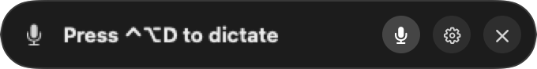
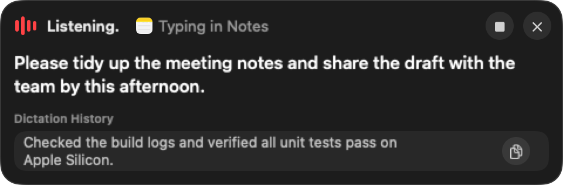
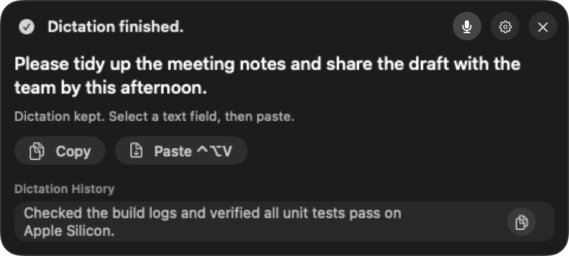
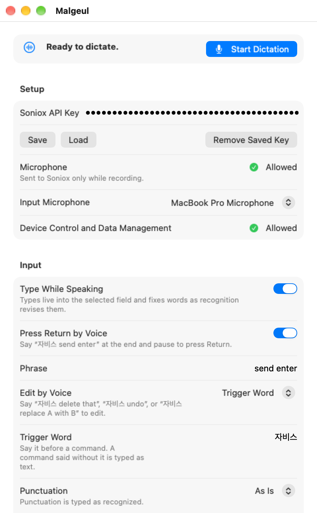
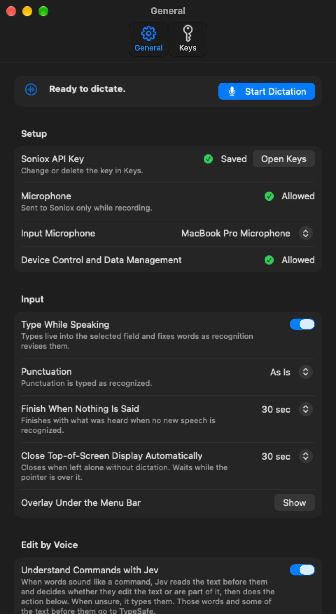

<p align="center">
  
</p>

<h1 align="center">Malgeul</h1>

<p align="center">
  Speak, and your words appear in the field you're typing in.
</p>

<p align="center">
  <a href="https://github.com/floweredao/malgeul/releases/latest"><b>Download</b></a>
  ·
  <a href="README-ko.md">한국어</a>
  ·
  macOS 15+ · Apple silicon
</p>

https://github.com/user-attachments/assets/5fa20082-573e-489c-92de-b7b39ca3aa9f

## Why Malgeul

- **Works everywhere.** Notes, a browser, a terminal: it types into the field you clicked.
- **Start and edit by voice.** Say "Hey Computer" to start. Say "delete that" or "undo" to fix.
- **Stays out of your way.** The overlay never takes focus. The result stays until you close it.

## Install

1. Download the `.zip` from the [latest release](https://github.com/floweredao/malgeul/releases/latest) and move the app to Applications.
2. Open the app and save your [Soniox](https://soniox.com) API key in Settings.
3. Allow Microphone and Accessibility.

> The downloaded file is named `Speech2Text.app`. On screen it shows as **Malgeul**. The file name is kept so permissions and updates carry over.

## How to use it

- **Start or finish**: <kbd>⌃</kbd><kbd>⌥</kbd><kbd>D</kbd> or "Hey Computer"
- **Paste the last result**: <kbd>⌃</kbd><kbd>⌥</kbd><kbd>V</kbd>
- **Cancel**: **Cancel Dictation** in the menu bar menu
- **Stops by itself**: after 30 seconds of silence

## Edit by voice

Say these while dictating.

| Say | What happens |
| --- | --- |
| "delete that" · "지워" | Deletes the last sentence |
| "delete last word" | Deletes the last word |
| "clear all" · "다 지워" | Deletes everything dictated so far |
| "undo" · "되돌려" | Undoes the last edit |
| "replace A with B" | Replaces the last A with B |
| "send enter" · "엔터 보내기" | Finishes and presses Return |

Settings › Input › **Edit by Voice** decides what counts as a command.

- **Jev Decides** (recommended): say just the command. TypeSafe Jev reads the words before it and decides. When unsure, it types the words. Needs a Jev API key.
- **Trigger Word**: only words right after your trigger word are commands. You set the word in Settings.
- **Off**: everything is typed.

## Start by voice

- **Wake phrase**: turn it on in Settings › Start by Voice. Say "Hey Computer" to start, and again at the end to finish.
- **Korean accents too**: from macOS 26, on-device speech recognition also hears "헤이 컴퓨터".
- **Audio stays on your Mac**: what the wake phrase listener hears is never stored or sent.
- **Shortcuts and Voice Control**: use the **Start Dictation** and **Finish Dictation** actions.

## A look around

When idle, it is one capsule under the notch.

<p align="center">
  
</p>

While you speak, it shows the live text and the app it types into.

<p align="center">
  
</p>

When you finish, the result stays with Copy and Paste buttons.

<p align="center">
  
</p>

The Settings window, light and then dark.

<p align="center">
  
</p>

<p align="center">
  
</p>

## Details

<details>
<summary><b>Permissions and setup</b></summary>

- **Soniox API key**: kept only in this app's own Keychain item. Soniox bills you separately.
- **Microphone**: macOS asks the first time you record. Pick one in Settings › **Input Microphone**.
- **Accessibility**: needed to type into other apps. Press **Request Access** in Settings.
- On macOS 27 this permission is called **Device Control and Data Management**.

</details>

<details>
<summary><b>Shortcuts</b></summary>

- Change each action's shortcut in Settings › **Shortcuts**.
- Key combos: a key with ⌃, ⌥ or ⌘, or F1–F20.
- Modifier-only: press and release modifiers alone, like both ⇧ or right ⌘.
- Multi-press: press the same key two or three times within 0.5 s while recording it.

</details>

<details>
<summary><b>How text gets in</b></summary>

- It types into the chosen field while you speak.
- Moving to another field stops live typing. The result stays in the overlay.
- Cancel removes only the characters this dictation typed.
- The app never presses Return on its own. "send enter" is the only exception.
- **Punctuation** in Settings › Input: as is, no commas, or none.
- Words in the **Dictionary** are recognized as written.

</details>

<details>
<summary><b>Troubleshooting</b></summary>

- **Text didn't go in**: use **Copy** or **Paste** (<kbd>⌃</kbd><kbd>⌥</kbd><kbd>V</kbd>) in the overlay.
- **Allowed, but it says no permission**: remove the app with **−** in System Settings and add it again with **+**.
- **Recording won't start**: the top of Settings shows what is missing.
- **Wake phrase doesn't work**: check the microphone and **Sensitivity** in Settings.
- **Live typing stops in a terminal**: terminals don't report the cursor. Paste after you finish.
- **Voice Control types twice**: switch Voice Control to Command Mode.
- **macOS won't open the app**: System Settings › Privacy & Security › **Open Anyway**.

</details>

<details>
<summary><b>Privacy</b></summary>

- Audio goes to Soniox only while you dictate.
- No recordings are saved.
- Dictation history lives in memory and is gone when the app quits.
- Wake phrase audio never leaves your Mac.

</details>

<details>
<summary><b>Build from source</b></summary>

Needs an Apple silicon Mac with the Xcode Command Line Tools.

```sh
bash scripts/test.sh        # tests
bash scripts/build-app.sh   # builds build/Speech2Text.app
```

- The wake phrase model is downloaded into `Vendor/` before building.
- Ad-hoc signing: `SPEECH2TEXT_SIGNING_IDENTITY=-`.
- `bash scripts/capture-readme-images.sh` redraws the pictures in this README.
- `bash scripts/record-demo-video.sh` films the demo video: it runs the app on a virtual display of its own and records it at 60 fps, so nothing appears on the screens you are working on. It needs Screen Recording permission.

</details>

## License

[MIT](LICENSE). Notices for the bundled open-source parts are in [THIRD_PARTY_NOTICES.md](THIRD_PARTY_NOTICES.md).
