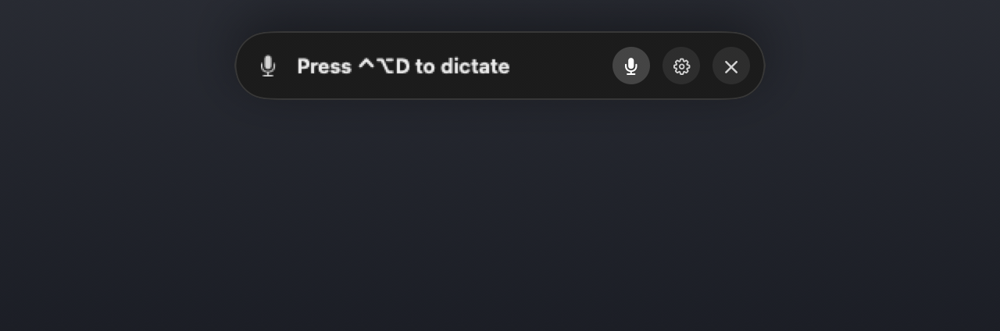

<p align="center">
  
</p>

<h1 align="center">말글 · Malgeul</h1>

<p align="center">
  Speak, and the words land in the text field you are already in.<br>
  A menu bar dictation app for macOS.
</p>

<p align="center">
  <b>English</b> · <a href="README-ko.md">한국어</a>
</p>

<p align="center">
  <a href="https://github.com/floweredao/malgeul/releases/latest"><b>Download the latest release</b></a>
  &nbsp;·&nbsp; macOS 15 or later, Apple silicon
  &nbsp;·&nbsp; <a href="LICENSE">MIT</a>
</p>

<p align="center">
  
</p>

## What it is

Malgeul is a small menu bar app. Click into any text field, press a shortcut (or say "Hey Computer"), and talk. The words are typed into that field while you speak, and a compact overlay under the notch shows what is being recognized. Speech goes to [Soniox](https://soniox.com) for recognition with your own API key; nothing is stored, and transcripts live only in memory until you quit.

It types what you said. It does not rewrite your sentences, and a spoken edit only counts when you ask for it with a trigger word.

## Why it is good

- **Types live, into the field you chose.** Standard Mac text fields are edited through accessibility; web editors and terminals get key events sent to that app only. When recognition revises an earlier word, only the changed tail is retyped.
- **Stays out of the way.** The overlay never takes keyboard focus, so you keep typing and clicking in your app. Drag it anywhere; it closes by itself after 30 seconds of quiet (configurable).
- **Nothing is lost.** The result stays until you dismiss it, with Copy and Paste for the times a field would not accept text. The last 20 dictations sit in a collapsible history, in memory only.
- **Edit by voice.** "자비스 지워" deletes the last sentence, "자비스 되돌려" undoes it, "자비스 A를 B로 바꿔" replaces a word, and "자비스 엔터 보내기" presses Return. English works too: "delete that", "undo", "replace A with B", "send enter". The trigger word (default "자비스") is yours to change.
- **Starts by voice.** Two Shortcuts actions, Start Dictation and Finish Dictation, work with the Shortcuts app and Voice Control. Or turn on the wake phrase and say "Hey Computer", recognized entirely on your Mac.
- **Korean and English.** The app, the overlay and this README come in both languages, and recognition is hinted toward Korean and English.
- **Keeps itself current.** Updates install from inside the app through GitHub Releases, with a daily check or **Check for Updates…** in the menu.

## A look around

The overlay sits under the notch. Idle, it is one capsule:

<p align="center">
  
</p>

While you speak, it shows the live transcript, the app it is typing into, and your earlier dictations:

<p align="center">
  
</p>

When you finish, the result stays with Copy and Paste in case it could not be typed:

<p align="center">
  
</p>

Settings holds the API key, microphone and permissions, input behavior, dictionary, shortcuts, and voice start. Light, then dark:

<p align="center">
  
  &nbsp;&nbsp;
  
</p>

The overlay is dark in both appearances by design.

## Install

1. Download the `.zip` from the [latest release](https://github.com/floweredao/malgeul/releases/latest), unzip it, and move `Speech2Text.app` to Applications. The bundle is still named `Speech2Text.app` on disk; it shows up as **Malgeul** (**말글** on a Korean Mac) in the menu bar, its windows and Settings. The file name and bundle identifier stay as they were so that permissions you already granted and the updater keep working.
2. Open it. If macOS says it cannot open the app, go to System Settings › Privacy & Security, scroll to Security, and click **Open Anyway**. Once per version.
3. From then on, updates install from inside the app.

## Set up

Open **Settings…** from the waveform icon in the menu bar. Settings opens by itself while something is missing.

1. **Soniox API key.** Paste it and press **Save**. The key is kept only in the app's own Keychain item and loaded on the next launch; **Remove Saved Key** deletes it from this Mac. Soniox usage charges apply.
2. **Microphone.** macOS asks the first time you record. Choose the microphone under **Input Microphone**; the default is the system input.
3. **Accessibility.** Live typing into other apps and modifier-only shortcuts need the permission that controls other apps. Press **Request Access**, then allow Malgeul in System Settings. On macOS 27 the pane is called **Device Control and Data Management**; on macOS 26 and earlier it is **Accessibility**. Settings refreshes the status when you come back.

If the list shows the app as allowed but it still reports no permission, remove the entry with **−** and add `/Applications/Speech2Text.app` again with **+**.

## Dictate

1. Click the text field you want to type into, in any app.
2. Press **⌃⌥D** and speak. Recording starts as soon as the microphone is on, so talk right away; the Soniox connection finishes in the background and is retried once if it fails. With no internet connection the app refuses to start and says so.
3. Press **⌃⌥D** again, click the stop button, or stop talking: after 30 seconds without new words the dictation finishes by itself (Settings › Input › **Finish When Nothing Is Said**). Recordings are limited to 30 minutes.

What to expect while typing live:

- If you move to another field or app mid-sentence, live typing stops and the result is kept in the overlay. Words you said before switching are never typed into the new field; what you say after goes there.
- In terminals, typing or clicking in the field also stops it, because terminals do not report where the cursor is. The app never sends Return on its own, so it cannot run a command. The spoken Return command is the one exception, and it goes to the same field only.
- Cancelling erases only the text typed in this dictation.
- **Punctuation** (Settings › Input): **As Is**, **Drop Commas** (periods, question and exclamation marks stay, and so do commas inside numbers like 1,000), or **Drop All** (numbers like 3.14 stay). Voice commands are matched on the words as heard.
- **Dictionary** (Settings › Dictionary): words listed here are sent to Soniox as context so they are recognized as written.

### Shortcuts

Settings › **Shortcuts** has one row per action: start/finish dictation (default ⌃⌥D), paste the last dictation (default ⌃⌥V), and cancel (no default). Click the shortcut button and press the keys you want; Esc cancels recording and ✕ turns a shortcut off.

- **Key chords**: a key with at least one of ⌃, ⌥, ⌘, or F1–F20. Keys that would block typing (a bare letter, ⇧ plus a letter) are refused.
- **Modifiers only**: press and release modifiers alone, such as both ⇧ keys, the right ⌘, or ⌘+⌥. Left and right count separately. Typing another key or clicking while holding, or holding longer than 0.6 seconds, does not count. Needs the Accessibility permission.
- **Multi-tap**: while recording a shortcut, press the same keys two or three times within 0.5 seconds to save a double or triple tap.

### Edit by voice

A command counts only right after the **trigger word** (Settings › Input, default "자비스"), so the same words said on their own are typed as text.

| Say | Effect |
| --- | --- |
| "자비스 지워" · "자비스 delete that" | Deletes the last sentence |
| "자비스 한 단어 지워" · "자비스 delete last word" | Deletes the last word |
| "자비스 다 지워" · "자비스 clear all" | Clears everything dictated so far |
| "자비스 되돌려" · "자비스 undo" | Undoes the last edit |
| "자비스 A를 B로 바꿔" · "자비스 replace A with B" | Replaces the last A with B |
| "자비스 엔터 보내기" · "자비스 send enter" | Finishes and presses Return in the same field |

Settings › Input › **Edit by Voice** can instead let **Jev** decide: say "지워", "되돌려" or "replace A with B" without a trigger word and the TypeSafe Jev model judges from the text before it whether you meant an edit. Only a phrase that ends in a command and up to 400 characters before it are sent; when Jev is unsure, fails, or takes over 1.5 seconds, the words are typed. The Jev API key lives in the app's Keychain. **Off** types everything.

## Start by voice

Malgeul adds two actions, **Start Dictation** and **Finish Dictation**, that the Shortcuts app and Voice Control can run. Start never ends a dictation that is already running, and Finish never starts one. Click the field you want first, as with the keyboard shortcut. Settings › **Start by Voice** shows the same steps.

- **Wake phrase** (off by default). Turn on **Start and Finish by Wake Phrase**, then say "Hey Computer" to start and say it again at the end to finish. Listening runs entirely on this Mac: a small keyword model built into the app, plus macOS's own on-device speech recognizer on macOS 26 and later. The recognizer is what hears "Hey Computer" said with a Korean accent ("헤이 컴퓨터"), which the English keyword model alone misses. Nothing it hears is stored or sent. The microphone stays on while it listens (the orange dot in the menu bar) and is handed to the dictation while you speak; a Bluetooth headset's sound quality can drop meanwhile. The phrase is a setting in English letters, with **Sensitivity** low, standard or high; a real English word is heard far more reliably than a made-up name.
- **Voice Control.** In the Shortcuts app, make a shortcut with the Malgeul action **Start Dictation**. In System Settings › Accessibility › Voice Control › Commands, click +, type the phrase you will say, set the action to **Run Shortcut**, and pick that shortcut. Do the same for **Finish Dictation**. Voice Control keeps listening while it is on and can type what you say itself; if text comes in twice, switch Voice Control to Command Mode.

## Troubleshooting

- **Nothing was typed.** The result is in the overlay. **Copy** puts it on the clipboard for ⌘V; **Paste** (or ⌃⌥V) sends it to the field that is selected now. The menu bar menu has Cancel Dictation, Copy Last Dictation and Paste Last Dictation too, reachable with ⌃F8 and the arrow keys. Some apps do not report whether a paste landed; then the overlay says **Paste requested** rather than claiming success.
- **"No permission" although the app is listed.** Remove the entry in the privacy pane with **−** and add `/Applications/Speech2Text.app` again with **+**. Modifier-only shortcuts need the same permission.
- **Recording will not start.** Settings shows which of the three setup items is missing. A missing key, a microphone that is denied, unavailable or silent, and a Soniox 401/403 are reported in the overlay with **Check Settings** only, because retrying would repeat them; every other error, including no internet connection, offers **Try Again** as well.
- **The wake phrase never fires.** Make sure the microphone it listens on is the one in Settings, raise **Sensitivity**, and prefer a real English word. On macOS 26 and later the system recognizer joins in only when an on-device model for one of your preferred languages is installed.
- **Live typing stops in a terminal.** Terminals do not expose the cursor, so any key or click there ends live typing. Finish, then paste.
- **Voice Control types the words twice.** Switch Voice Control to Command Mode.
- **macOS refuses to open the app.** System Settings › Privacy & Security › Security › **Open Anyway**, once per version.

## Build from source

Requires Xcode and the Command Line Tools on Apple silicon.

```sh
bash scripts/test.sh          # unit tests
bash scripts/build-app.sh     # build/Speech2Text.app, signed with "Apple Development" by default
```

`scripts/fetch-wake-model.sh` downloads the pinned sherpa-onnx libraries and the keyword model into `Vendor/` (not committed) before a build or test run. Set `SPEECH2TEXT_SIGNING_IDENTITY=-` for an ad-hoc signature. `bash scripts/capture-readme-images.sh` renders the screenshots and GIFs in `docs/images` through the app's own `--demo-capture` mode: synthetic text, no microphone, network or window on screen.

## Privacy

Audio is sent to Soniox only while a dictation runs, over a connection authorized with your key. The wake phrase is heard on this Mac only. Nothing is recorded to disk, transcripts and the dictation history live in memory and disappear when the app quits, and the app does not capture the screen.

## License

Malgeul is released under the [MIT License](LICENSE). The app also ships Sparkle, sherpa-onnx, ONNX Runtime and a keyword model under their own licenses; see [THIRD_PARTY_NOTICES.md](THIRD_PARTY_NOTICES.md).
